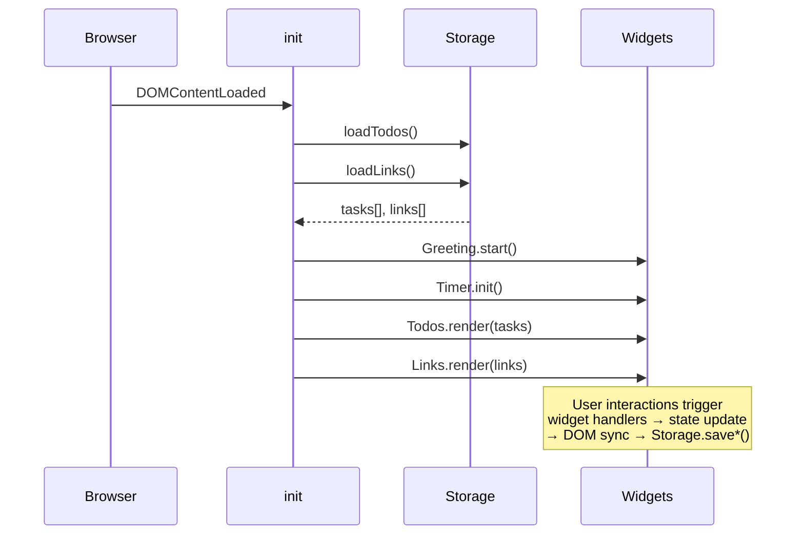

# Design Document

## Overview

The To-Do List Life Dashboard is a single-page, fully client-side web application delivered as three plain files: `index.html`, `css/style.css`, and `js/app.js`. It requires no build step, no backend, and no third-party libraries. All runtime data is stored in the browser's `localStorage` API.

The application renders four independent widgets in a responsive grid layout:

1. **Greeting Widget** — displays the current time (24-hour HH:MM), full local date, and a time-based greeting.
2. **Focus Timer** — a 25-minute Pomodoro-style countdown with Start, Stop, and Reset controls.
3. **To-Do List** — a task manager with add, edit, complete, and delete operations.
4. **Quick Links** — a configurable panel of shortcut buttons that open URLs in new tabs.

The design prioritises simplicity: a single, small JavaScript module with clear function boundaries, no global mutation outside a well-defined state object, and defensive localStorage handling throughout.

---

## Architecture

### High-Level Structure

```
index.html          ← semantic HTML skeleton; widget containers only
css/style.css       ← all visual styles, responsive layout, widget theming
js/app.js           ← all application logic
  ├── State         ← single source of truth object
  ├── Storage       ← localStorage read/write helpers
  ├── Greeting      ← time/date rendering + 60-second ticker
  ├── Timer         ← Pomodoro countdown logic
  ├── Todos         ← task CRUD + DOM sync
  ├── Links         ← quick-link CRUD + DOM sync
  └── init()        ← wires everything on DOMContentLoaded
```

### Execution Flow



### Key Design Decisions

- **No framework**: vanilla DOM APIs keep the bundle to zero bytes of external code and guarantee cross-browser compatibility without a polyfill layer.
- **Single state object**: all mutable data lives in one `state` object (`state.todos`, `state.links`, `state.timer`), making reads and writes easy to audit.
- **Defensive localStorage**: every read/write is wrapped in `try/catch`; failures degrade gracefully to an in-memory-only session.
- **Widget isolation**: each widget's logic is a plain object literal (`Greeting`, `Timer`, `Todos`, `Links`) — no shared state between widgets except through `state`.

---

## Components and Interfaces

### Greeting Widget

**Responsibilities**
- Read `Date` once per render cycle and derive time string, date string, and greeting label.
- Start a `setInterval` at 60-second intervals to refresh the display.

**Public interface**

```js
Greeting.start()   // called once at init; kicks off the 60-second interval
Greeting.render()  // called internally each tick; updates DOM nodes
```

**DOM targets** (IDs defined in `index.html`)

| ID | Content |
|----|---------|
| `#greeting-time` | "HH:MM:SS" |
| `#greeting-date` | "Day, DD Month YYYY" |
| `#greeting-text` | "Good Morning / Afternoon / Evening / Night" |

**Greeting rules**

| Time range | Greeting |
|-----------|---------|
| 05:00 – 11:59 | Good Morning |
| 12:00 – 17:59 | Good Afternoon |
| 18:00 – 21:59 | Good Evening |
| 22:00 – 04:59 | Good Night |

---

### Focus Timer

**Responsibilities**
- Maintain remaining seconds in `state.timer.remaining` (initial: 1500).
- Run a `setInterval` at 1-second intervals while active.
- Show session-complete notification when remaining reaches 0.

**Public interface**

```js
Timer.init()    // renders initial display; binds Start/Stop/Reset buttons
Timer.start()   // begins or resumes countdown
Timer.stop()    // pauses countdown, retains remaining time
Timer.reset()   // clears interval, restores remaining to 1500, hides notification
Timer.tick()    // called each second; decrements, updates display, checks for 00:00
Timer.format(seconds) → "MM:SS"   // pure formatting helper
```

**State shape** (within `state.timer`)

```js
{
  remaining: 1500,   // seconds left
  intervalId: null,  // setInterval handle or null when stopped
  running: false     // boolean
}
```

**DOM targets**

| ID | Content |
|----|---------|
| `#timer-display` | "MM:SS" |
| `#timer-start` | Start button |
| `#timer-stop` | Stop button |
| `#timer-reset` | Reset button |
| `#timer-complete` | Session-complete notification (hidden by default) |

---

### To-Do List

**Responsibilities**
- Maintain `state.todos` as an array of `Task` objects.
- Sync the DOM list on every state change.
- Persist to localStorage within 500 ms of any mutation.

**Public interface**

```js
Todos.init()                      // loads from storage, renders
Todos.add(description)            // validates, creates Task, renders, saves
Todos.toggle(id)                  // flips Task.done, renders, saves
Todos.startEdit(id)               // swaps display span for edit input
Todos.confirmEdit(id, newDesc)    // validates, saves update, renders, saves
Todos.cancelEdit(id)              // reverts to display mode
Todos.delete(id)                  // removes Task, renders, saves
Todos.render()                    // full DOM sync from state.todos
Todos.save()                      // Storage.saveTodos(state.todos)
```

**Validation rules**

| Rule | Behaviour on failure |
|------|---------------------|
| Description is empty or whitespace-only | Reject; show error adjacent to input field |
| Description > 500 characters | Reject; show error adjacent to input field |
| Edit confirmed with empty/whitespace-only description | Reject change; revert to display mode silently |

**DOM targets**

| ID / selector | Purpose |
|--------------|---------|
| `#todo-input` | New task text field |
| `#todo-add-btn` | Add button |
| `#todo-error` | Inline error message element |
| `#todo-list` | `<ul>` container; children are rendered `<li>` items |

---

### Quick Links

**Responsibilities**
- Maintain `state.links` as an array of `Link` objects (max 20).
- Auto-prepend `https://` to URLs that start with neither `http://` nor `https://`.
- Open links in a new browser tab.
- Persist to localStorage immediately on any mutation.

**Public interface**

```js
Links.init()                      // loads from storage, renders
Links.add(label, url)             // validates, normalises URL, creates Link, renders, saves
Links.delete(id)                  // removes Link, renders, saves
Links.openLink(url)               // window.open(url, '_blank', 'noopener,noreferrer')
Links.render()                    // full DOM sync from state.links
Links.save()                      // Storage.saveLinks(state.links)
```

**Validation rules**

| Rule | Behaviour on failure |
|------|---------------------|
| Label empty | Reject; show inline error next to label field |
| Label > 50 characters | Reject; show inline error next to label field |
| URL empty | Reject; show inline error next to URL field |
| URL > 2048 characters | Reject; show inline error next to URL field |
| 20 links already saved | Reject; show inline error indicating limit reached |

**URL normalisation**: if the submitted URL does not begin with `http://` or `https://` (case-insensitive), prepend `https://` before saving.

**DOM targets**

| ID / selector | Purpose |
|--------------|---------|
| `#link-label-input` | Label text field |
| `#link-url-input` | URL text field |
| `#link-add-btn` | Add button |
| `#link-label-error` | Inline error for label field |
| `#link-url-error` | Inline error for URL field |
| `#links-list` | Container for rendered link buttons |

---

### Storage Module

Centralises all `localStorage` interactions. Every method wraps its body in `try/catch` and returns a safe default on failure.

```js
Storage.loadTodos()          → Task[]   // default []
Storage.saveTodos(tasks)     → void     // fails silently; shows no UI error
Storage.loadLinks()          → Link[]   // default []
Storage.saveLinks(links)     → void     // on quota/unavailable: displays widget-level error
```

Storage keys:

| Key | Value |
|-----|-------|
| `tld_todos` | JSON-serialised `Task[]` |
| `tld_links` | JSON-serialised `Link[]` |

---

## Data Models

### Task

```js
{
  id:          string,   // crypto.randomUUID() or Date.now().toString() fallback
  description: string,   // 1–500 characters
  done:        boolean,  // false on creation
  createdAt:   number    // Date.now() timestamp
}
```

### Link

```js
{
  id:    string,   // crypto.randomUUID() or Date.now().toString() fallback
  label: string,   // 1–50 characters
  url:   string    // 1–2048 characters, always starts with http:// or https://
}
```

### State

```js
const state = {
  todos: [],          // Task[]
  links: [],          // Link[]
  timer: {
    remaining:  1500, // seconds
    intervalId: null, // number | null
    running:    false
  }
};
```

### localStorage Serialisation

Both `Task[]` and `Link[]` are serialised with `JSON.stringify` and deserialised with `JSON.parse`. On any parse error (corrupted data, missing key), the module returns the empty-array default and the widget initialises with an empty list — no data is written back until the user makes a change.

---

## Correctness Properties

*A property is a characteristic or behavior that should hold true across all valid executions of a system — essentially, a formal statement about what the system should do. Properties serve as the bridge between human-readable specifications and machine-verifiable correctness guarantees.*

### Property 1: Greeting correctness for all valid times

*For any* local time value between 00:00 and 23:59, the greeting function SHALL return exactly one of the four defined greeting strings, and the returned string SHALL be the one whose time range contains the input hour.

**Validates: Requirements 1.3, 1.4, 1.5, 1.6**

---

### Property 2: Timer format round-trip

*For any* integer number of seconds in the range [0, 1500], `Timer.format(seconds)` SHALL return a string of the form "MM:SS" where MM and SS are zero-padded two-digit integers, and parsing that string back as `minutes * 60 + seconds` SHALL yield the original input.

**Validates: Requirements 2.3**

---

### Property 3: Task addition grows the list by exactly one

*For any* to-do list and any valid task description (1–500 non-whitespace-only characters), calling `Todos.add(description)` SHALL increase `state.todos.length` by exactly 1, and the last element SHALL have the submitted description and `done: false`.

**Validates: Requirements 3.1**

---

### Property 4: Whitespace-only and empty task descriptions are always rejected

*For any* string that is empty or composed entirely of whitespace characters, `Todos.add(description)` SHALL leave `state.todos` unchanged.

**Validates: Requirements 3.2**

---

### Property 5: Task addition round-trip through localStorage

*For any* valid task, after `Todos.add(description)` is called, serialising `state.todos` to JSON and then deserialising it SHALL produce a `Task[]` where every field of the new task is preserved exactly.

**Validates: Requirements 3.8**

---

### Property 6: Toggle is an involution

*For any* task in `state.todos`, calling `Todos.toggle(id)` twice in succession SHALL leave the task's `done` field equal to its value before the first call.

**Validates: Requirements 3.3**

---

### Property 7: Valid URL normalisation idempotence

*For any* URL that already begins with `http://` or `https://`, the normalisation step SHALL leave it unchanged.

**Validates: Requirements 4.3**

---

### Property 8: Link list never exceeds 20 entries

*For any* link list at the 20-entry limit, calling `Links.add(label, url)` with a valid label and URL SHALL leave `state.links.length` equal to 20.

**Validates: Requirements 4.8**

---

### Property 9: Link addition round-trip through localStorage

*For any* valid link, after `Links.add(label, url)` is called, serialising `state.links` to JSON and then deserialising it SHALL produce a `Link[]` where the label and normalised URL of the new link are preserved exactly.

**Validates: Requirements 4.6, 4.7**

---

## Error Handling

### localStorage Unavailability

| Scenario | Behaviour |
|---------|----------|
| `localStorage` throws on read (load) | Widget initialises with empty list; no error shown to user |
| `localStorage` throws on write (save todos) | Silent fail; in-memory state is still updated |
| `localStorage` throws on write (save links) | Error message shown inside the Quick Links widget; previous saved state preserved |
| Stored JSON is unparseable | Default empty array used; existing storage key is left untouched |

### Widget Render Failure

If a widget's rendering function throws an unhandled exception, a global `window.onerror` handler will catch it, mark the affected widget container with an error banner ("Widget failed to load"), and allow the remaining widgets to continue operating.

### Input Validation Errors

All validation errors surface as inline messages adjacent to the offending input field. Error messages are cleared on the next successful submission or when the user begins typing again. No form submission causes a page reload — all interactions are fully in-place DOM operations.

### Timer Edge Cases

- Activating Start while the timer is already running is a no-op (guarded by `state.timer.running`).
- Activating Start when remaining is 0 is a no-op (timer has completed; user must Reset first).

---

## Testing Strategy

### Unit Tests

Unit tests cover pure functions and edge-case validation logic:

- `Greeting.getGreeting(hour)` — 24 boundary inputs covering each of the four greeting ranges and their adjacent edges.
- `Timer.format(seconds)` — values 0, 1, 59, 60, 1499, 1500 and a selection of random mid-range values.
- `Todos.add` — valid descriptions, whitespace-only strings, empty string, descriptions at exactly 500 characters and 501 characters.
- `Links.add` — valid input, empty label, label of 51 chars, empty URL, URL of 2049 chars, URL without protocol, link list at 20 entries.
- `Storage.loadTodos` / `Storage.loadLinks` — simulated `localStorage` unavailability and corrupted JSON strings.

### Property-Based Tests

Property-based tests use [fast-check](https://github.com/dubzzz/fast-check) and are configured with a minimum of 100 iterations per property.

Each test is tagged with:
> **Feature: todo-life-dashboard, Property {N}: {property_text}**

| Property | fast-check generator | What is verified |
|---------|---------------------|-----------------|
| P1: Greeting correctness | `fc.integer({min:0, max:23})` for hour | Returned string is one of the four valid greetings and matches the correct range |
| P2: Timer format round-trip | `fc.integer({min:0, max:1500})` | Parsed value equals input |
| P3: Task addition grows list by 1 | `fc.string({minLength:1, maxLength:500})` filtered to non-whitespace-only | `state.todos.length` increases by 1; last entry has correct description and `done: false` |
| P4: Whitespace tasks rejected | `fc.stringOf(fc.constantFrom(' ','\t','\n'))` | `state.todos` unchanged |
| P5: Task localStorage round-trip | `fc.string({minLength:1, maxLength:500})` filtered to non-whitespace-only | JSON serialise → deserialise preserves all task fields |
| P6: Toggle is involution | existing `state.todos` with at least one task, `fc.nat` index | `task.done` same after two toggles |
| P7: URL normalisation idempotence | `fc.webUrl()` (already valid URLs) | Normalised URL equals original |
| P8: Link list capped at 20 | link list pre-filled to 20 entries, `fc.record({label, url})` | `state.links.length` remains 20 |
| P9: Link localStorage round-trip | `fc.record({label: fc.string({minLength:1,maxLength:50}), url: fc.webUrl()})` | JSON serialise → deserialise preserves label and URL |

### Integration Tests

- Full `init()` call with a pre-populated `localStorage` mock verifies that all four widgets render their saved data correctly.
- Simulated `localStorage` unavailability at startup verifies all four widgets fall back to their empty-state defaults without throwing.
- End-to-end interaction sequence (add task → complete → delete → verify `localStorage` state) run against a real browser DOM using a lightweight test harness (e.g., jsdom or a Playwright smoke test).

### Accessibility and Cross-Browser

- Manual keyboard navigation check for all interactive controls (Tab order, Enter/Space activation).
- Contrast ratio verified with a browser devtools accessibility audit for the chosen colour palette.
- Smoke tests run in Chrome, Firefox, Edge, and Safari to confirm no console errors on load.
